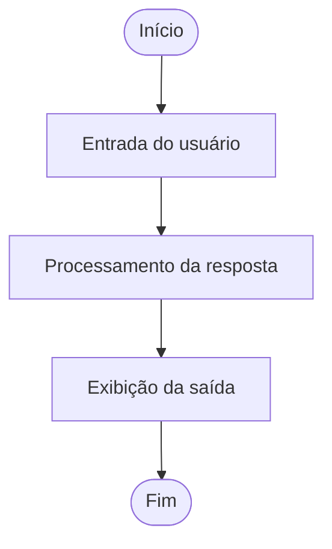

# 🤖 Explorando Agentes Autônomos com LangGraph

## 📌 Sobre o projeto

Este projeto foi desenvolvido durante meus estudos no curso **Agentes Autônomos (Agentic AI), da FIAP**, utilizando Python e LangGraph no ambiente Google Colab.

O objetivo é explorar os fundamentos da construção de fluxos de execução para aplicações de Inteligência Artificial, compreendendo como estruturar etapas, gerenciar estados e conectar diferentes processos por meio de grafos.

## 🎯 Objetivos de aprendizagem

- Compreender os fundamentos do LangGraph.
- Explorar a criação e o gerenciamento de estados (`State`).
- Implementar nós (`Nodes`) responsáveis por diferentes etapas de processamento.
- Estabelecer conexões e fluxos de execução entre os nós (`Edges`).
- Compilar e executar um grafo utilizando `StateGraph`.
- Visualizar a arquitetura do fluxo com Mermaid.

## ⚙️ Arquitetura do fluxo

O projeto implementa um fluxo sequencial composto por três etapas principais:

### Etapas implementadas

**1. Entrada do usuário (`entrada_usuario`)**

Recebe a mensagem enviada pelo usuário e realiza uma validação para verificar se a entrada não está vazia.

**2. Processamento (`processamento_resposta`)**

Recebe a pergunta armazenada no estado e realiza o processamento, construindo uma resposta simulada.

**3. Saída (`saida_resposta`)**

Apresenta o resultado final do processamento.

### Gerenciamento de estado

O projeto utiliza uma estrutura de estado (`State`) para armazenar e compartilhar informações entre as diferentes etapas do grafo.

A execução é realizada por meio da compilação do fluxo e da chamada do método `invoke()`.

## 🛠️ Tecnologias e ferramentas

| Tecnologia | Aplicação |
|---|---|
| Python | Linguagem de programação |
| LangGraph | Construção e execução de grafos |
| LangChain Core | Ecossistema de componentes para aplicações com LLMs |
| Typing Extensions | Suporte à definição de estruturas e tipagem |
| Mermaid | Representação visual do fluxo |
| Google Colab | Ambiente de desenvolvimento e execução |

## 🚀 Como executar

1. Acesse o notebook disponível neste repositório.
2. Abra o arquivo no Google Colab.
3. Execute as células na sequência apresentada.
4. Informe uma mensagem para testar o fluxo.
5. Observe o processamento e a resposta gerada.

## 📚 Principais aprendizados

Durante o desenvolvimento, explorei conceitos fundamentais para a construção de aplicações baseadas em agentes e fluxos de Inteligência Artificial:

- Organização de processos por meio de grafos.
- Gerenciamento e compartilhamento de estados.
- Estruturação de componentes independentes.
- Encadeamento de etapas de execução.
- Compilação e execução de fluxos com LangGraph.

## 🔭 Próximos passos

Como evolução deste experimento, pretendo explorar:

- Integração com modelos de linguagem (LLMs).
- Memória de conversação.
- Fluxos condicionais e tomada de decisão.
- Tratamento de erros e validação de respostas.
- Integração de ferramentas externas.

## 🎓 Contexto acadêmico

Projeto desenvolvido como parte dos estudos do curso **Agentes Autônomos (Agentic AI) — FIAP**.

Este repositório representa uma etapa da minha jornada de aprendizado em Inteligência Artificial, com foco em Python, Agentic AI e desenvolvimento de soluções inteligentes.

---

### 👩‍💻 Desenvolvido por Rayssa Teixeira

Estudante de Engenharia de Software | UI/UX Designer | Desenvolvedora Front-End | AI Enthusiast

🔗 [LinkedIn](https://linkedin.com/in/rayssa-teixeira-a1b0b5206)

💻 [GitHub](https://github.com/RT-cyber)
